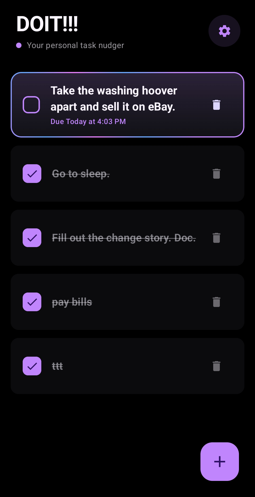
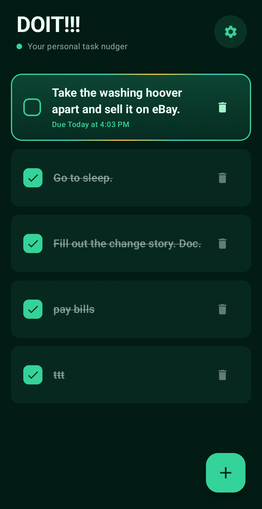
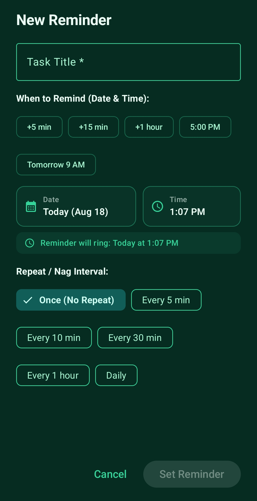
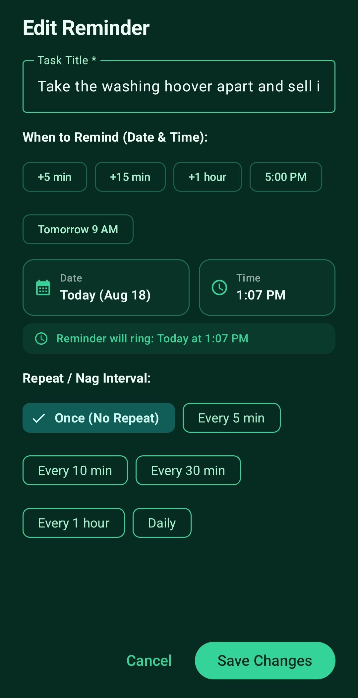
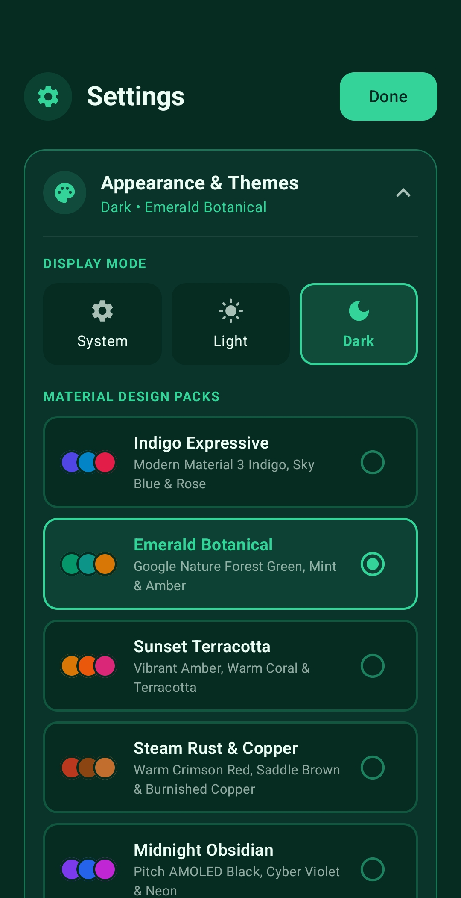
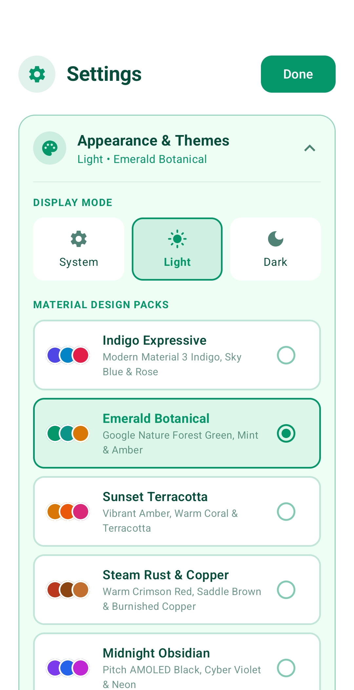
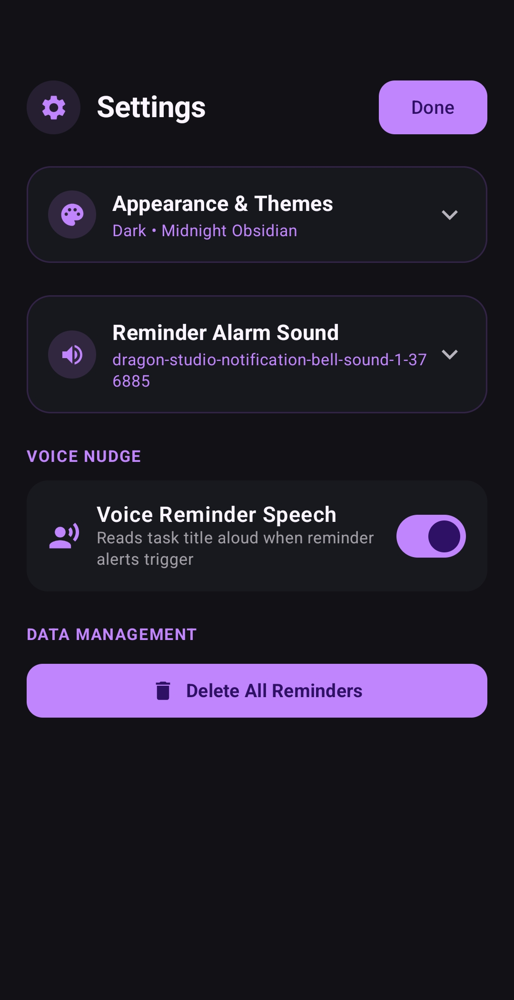
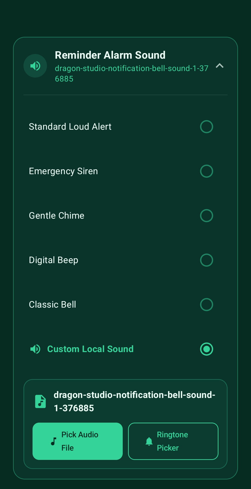
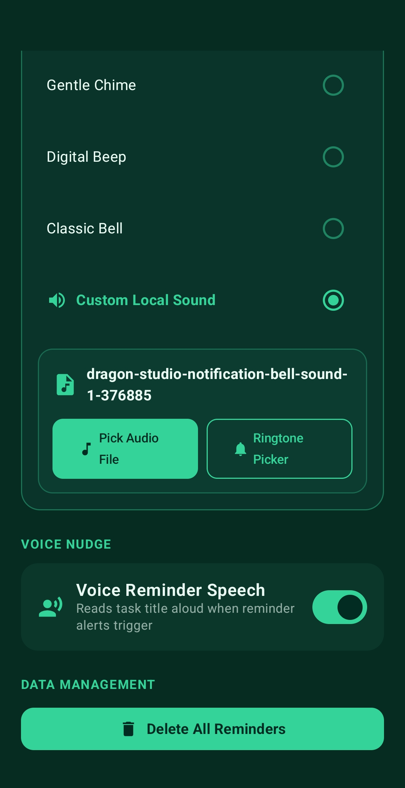
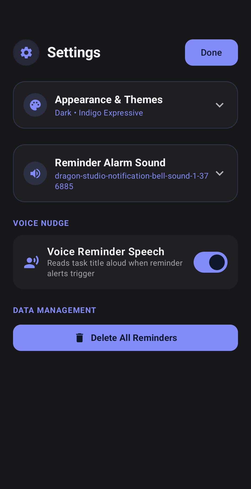

  

<h1 align="center">DOIT!!! — Android App</h1>

  <strong>The to-do list that refuses to be ignored — exact repeating alarms, a flashing fullscreen lock-screen takeover, and a voice that repeats your task until you do it.</strong>

  <a href="https://github.com/icelanderus/DOIT-Android-App/releases/latest/download/DOIT.apk"><strong>⬇ Download the latest APK</strong></a>
   
  Current version: <strong>5.0</strong>
   
  No ads · No account · No subscription

  <a href="assets/doit-demo.mp4"><strong>▶ Watch the demo video</strong></a>

---

## What is DOIT!!!?

Most task apps are polite: they show a notification, you swipe it away, and it's gone. DOIT!!! is not polite.

Add a task, choose how many times a day it should nag you (from 1 to 24), and walk away. When the time comes, DOIT!!! hunts you down — fullscreen, loud, and talking — until you press **I DID IT!**

## Open source — coming soon

The source code isn't in this repo yet — but it's coming. DOIT!!! will be open source soon, and the files will be uploaded right here.

⭐ **Star and watch this repo, subscribe for updates, and stay tuned.**

> This repository is the public download page: description, screenshots, demo video, the app icon and releases. It contains no source code yet.

## What it does

- **Exact repeating alarms** — scheduled with `AlarmManager.setExactAndAllowWhileIdle`, so nudges still fire in Doze mode instead of being silently delayed until the next morning.
- **Fullscreen lock-screen takeover** — the reminder wakes the screen, dismisses the keyguard and paints a flashing red **DO IT NOW!!!** overlay on top of everything else.
- **Alarm + vibration + voice** — a looping alarm, an aggressive vibration pattern, and a text-to-speech voice that repeats your task until you comply.
- **No escape hatch** — the back button is intentionally disabled. The only way out is the big **I DID IT!** button.
- **Built on a foreground service** — a `specialUse` foreground service plus a wake lock keep the alarm alive for up to 15 minutes, even with the screen off.
- **1–24 reminders per day** — every task shows its own repeat / nag interval (every 5 min, 10 min, 30 min, 1 hour, daily…), so you always know exactly what to expect.
- **Themes that recolor the whole app** — Material Design packs (Indigo Expressive, Emerald Botanical, Sunset Terracotta, Steam Rust & Copper, Midnight Obsidian and more) with System / Light / Dark display modes, as seen in the screenshots below.
- **Your alarm, your sound** — built-in alarm sounds (Standard Loud Alert, Emergency Siren, Gentle Chime, Digital Beep, Classic Bell) or a custom local sound: pick any audio file or a system ringtone.
- **Voice Reminder Speech** — optionally reads the task title aloud when a reminder triggers.
- **Test mode** — start a task title with `test` and the first reminder fires in 10 seconds for instant validation.
- **Permission guidance** — an in-app banner walks you through notification, overlay and exact-alarm access in the correct order.

## Screenshots

Real captures of the app from the author's phone:

## Install

1. Download the APK from the link above.
2. Open it and allow installing from the browser when Android asks (this is normal for apps installed outside Google Play).
3. Open DOIT!!!, grant the permissions it walks you through (notifications, overlay, exact alarms), and add your first task.
4. Try it first: name a task starting with `test` — it will nag you in 10 seconds.

## Privacy

- Your tasks live in a local database on your phone.
- No accounts, no sign-up.
- **AD FREE!!!** — no ads, no subscriptions, no nonsense.

## Notes

- Android may warn that the app comes from outside Google Play — that is expected for direct APK installs. Every version is an update of the same app.
- Requires Android 7.0 (API 24) or newer.

## Keywords

android todo app, task manager, reminder app, alarm reminder, nagging to-do list, repeating alarms, lock screen reminder, voice reminder, no ads todo, kotlin, jetpack compose
